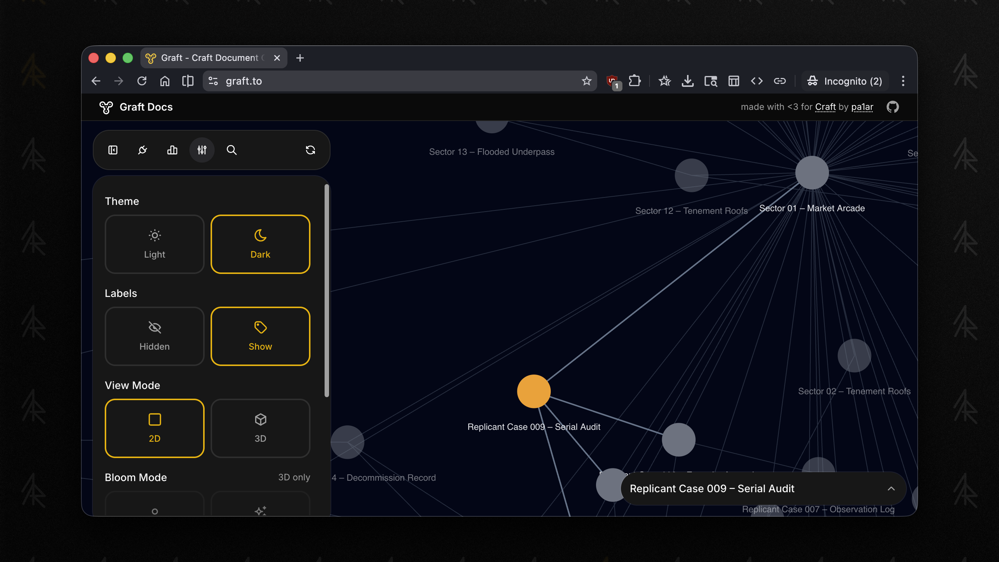
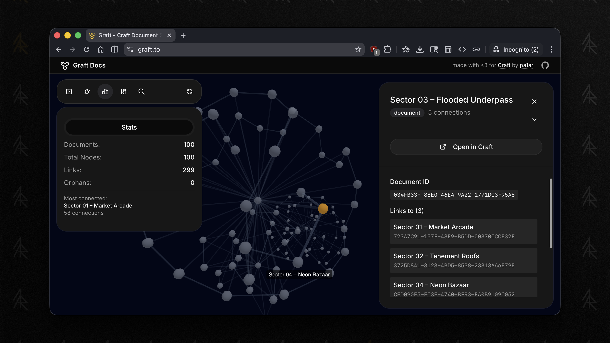

<div align="center">


# Craft Graph View

문서 링크·태그·폴더 관계를 2D·3D 그래프로 탐색합니다.

[English](README.md) · **한국어**

  [](LICENSE)

[로컬 시작](#로컬-시작) · [데이터 흐름](#데이터-흐름) · [명령](#명령)

</div>

---

## 소개

Craft 문서 그래프 앱 **Graft**를 수정한 프로젝트입니다. [lib/craft-config.ts](lib/craft-config.ts)에 고정 Craft 연결을 설정해 두었으며, 연결 화면에서 API 키를 입력받지 않습니다.



## 기능

- 문서 관계를 힘 기반 2D·3D 그래프로 표시합니다.
- 문서 미리보기·Craft 바로가기·그래프 통계를 제공합니다.
- 문서 링크·태그·폴더에서 연결 관계를 추출합니다.
- IndexedDB에 저장하고 수정 시각을 비교해 바뀐 문서만 갱신합니다.
- 이 수정본에는 태그 이름 변경 UI, 리서치 경로, 선택적 AI 요약이 포함되어 있습니다.



## 로컬 시작

Bun, 설정된 Craft 자료에 대한 접근, 3D 화면용 WebGL 지원 브라우저가 필요합니다.

```bash
git clone https://github.com/wilgon456/craft_graph_view.git
cd craft_graph_view
bun install
bun dev
```

[http://localhost:3000](http://localhost:3000)을 엽니다. 설정한 Craft 자료를 자동으로 사용합니다. 본인의 자료를 사용하려면 `lib/craft-config.ts`를 수정하세요. `localStorage`에 저장된 `craft_api_url`은 기본값보다 우선할 수 있습니다.

기존 npm 대체 실행 방법도 유지합니다.

```bash
npm install --legacy-peer-deps
npm run dev
```

## 데이터 흐름

```text
Craft API <-> Next.js 프록시 <-> 브라우저 그래프 + IndexedDB 저장
```

브라우저는 `/api/craft/[...path]`로 요청합니다. Next.js 서버가 요청 헤더와 Craft 응답을 받아 전달하므로 **문서 내용은 서버를 통과합니다.** 데이터 전송이 브라우저 안에서만 일어나는 것은 아닙니다.

그래프와 캐시는 브라우저에 저장하며 앱 데이터베이스는 없습니다. 프록시는 출처·경로 검사와 메모리 기반 IP별 제한을 포함합니다. 오류 로그도 있으므로 민감한 문서를 연결하기 전에 경로 구현과 호스팅 로그를 확인해 주세요.

## 연결과 선택적 AI

| 영역 | 설정·동작 |
| --- | --- |
| Craft 자료 | `lib/craft-config.ts`의 기본값. 브라우저 저장 URL이 우선할 수 있음 |
| 프록시 | GET 및 제한된 POST·PUT 경로. DELETE 거부 |
| 요약 | `ENABLE_AI_SUMMARIZE=true`일 때 활성화. `OPENROUTER_API_KEY` 사용 |
| 리서치 | 서버의 `OPENAI_API_KEY`를 사용하며 결과를 Craft에 쓸 수 있음 |
| 분석 | Vercel Analytics 포함 |

AI 경로를 켜면 문서 내용이 외부 공급자로 전송될 수 있습니다. 서버 API 키는 저장소 밖에 두고, 배포 공개 전에 쓰기 동작을 검토하세요. 소스가 공개되어 있어도 개인 Craft 문서의 접근 권한이 생기는 것은 아닙니다.

## 명령

```bash
bun test
bun lint
bun build
bun start
```

## 파일 구성

| 경로 | 용도 |
| --- | --- |
| `lib/graph/` | 파싱·조회·캐시·그래프 처리 |
| `components/graph/` | 2D·3D 화면·설정·미리보기 |
| `app/api/craft/` | Craft API 프록시 |
| `app/api/summarize/` | 선택적 AI 요약 |
| `app/api/research/` | 리서치 및 Craft에 결과 쓰기 |
| `hooks/use-craft-graph.ts` | 브라우저 그래프 동작 연결 |
| `public/` | 스크린샷·아이콘·예제 그래프 |

[CLAUDE.md](CLAUDE.md), [그래프 라이브러리 설명](lib/graph/CLAUDE.md), [화면 설명](components/graph/CLAUDE.md)에서 구조를 확인할 수 있습니다.

## 호스팅과 출처

Bun 기반 호스팅용 `vercel.json`이 포함되어 있습니다. 배포 전에 본인의 Craft 자료와 선택적 서버 자격증명을 설정하세요. 스크린샷은 원본 Graft에서 가져온 것으로 수정본 화면과 다를 수 있습니다.

원본 Graft: [graft.to](https://graft.to), [1ar.io/tools/graft](https://1ar.io/tools/graft). [MIT 라이선스](LICENSE).
